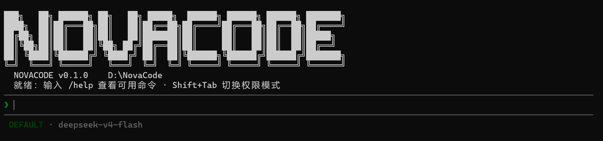

# NovaCode

从零实现的终端 AI 编程助手（类 Claude Code），使用 Python 3.12 开发。

NovaCode 把终端变成你的 AI 结对编程伙伴：它能读写文件、执行命令、搜索代码，还能协调多个子智能体并行工作——由自主执行循环（ReAct）驱动，支持流式输出与完整的权限控制。



## ✨ 功能特性

- **多协议 LLM**：统一封装 Anthropic 与 OpenAI 两种大模型协议（含 DeepSeek 兼容端点），支持流式输出与多轮对话。
- **自主执行循环（ReAct）**：智能体自主完成「思考 → 调用工具 → 观察结果」的循环；工具执行支持批处理（连续只读并发、有副作用串行）与取消/超时处理。
- **工具系统**：内置读/写/改文件、命令执行、glob、代码搜索等工具，支持通过 MCP（Model Context Protocol）与技能包（Skill）扩展。
- **上下文管理**：两层压缩机制（超大工具结果落盘 + LLM 结构化摘要），配合 token 估算、重试与熔断；同时支持跨会话长期记忆。
- **权限系统**：五层防御——危险命令黑名单、路径沙箱（解析软链接防越界）、规则引擎、模式兜底、人在回路审批。
- **多智能体协作**：主智能体可创建团队、派生子智能体在独立 Git Worktree 中隔离运行，通过文件信箱 + 跨进程文件锁协调通信。
- **命令框架与 Hooks**：内置斜杠命令体系（带自动补全），支持生命周期 Hook（shell / prompt / HTTP）实现自动化。

## 🧱 架构

```
src/novacode/
├── agent/        # ReAct 循环、子智能体执行、fork
├── tool/         # 工具注册中心 + 6 个核心工具 + 过滤
├── llm/          # LLM 适配层（Anthropic / OpenAI）
├── prompt/       # 模块化系统提示装配
├── permission/   # 五层权限流水线
├── compact/      # 上下文压缩 + token 估算
├── memory/       # 长期记忆
├── session/      # JSONL 会话持久化
├── mcp/          # MCP 客户端
├── skills/       # 技能包
├── hook/         # 生命周期 Hook
├── subagent/     # 子智能体角色定义
├── task/         # 后台任务管理
├── worktree/     # Git worktree 隔离
├── team/         # 多智能体团队协作
├── command/      # 斜杠命令框架
└── tui/          # 终端界面（prompt_toolkit + Rich）
```

## 🛠 技术栈

Python 3.12 · asyncio · prompt_toolkit · Rich · Anthropic SDK · OpenAI SDK · MCP · PyYAML

## 🚀 快速开始

### 环境要求

- Python 3.12+
- [uv](https://docs.astral.sh/uv/)（推荐）或 pip

### 安装

```bash
git clone https://github.com/gczhuang-cmd/novacode.git
cd novacode
uv sync            # 或：pip install -e .
```

### 配置

```bash
cp .novacode/config.yaml.example .novacode/config.yaml
```

编辑 `.novacode/config.yaml`，填入你的大模型服务商凭证：

```yaml
providers:
  - name: "DeepSeek"
    protocol: openai
    api_key: "sk-xxxxx"           # 你的 API Key
    model: "deepseek-v4-flash"
    base_url: "https://api.deepseek.com"
    context_window: 1000000
```

### 运行

```bash
uv run novacode      # 或：python -m novacode
```

输入请求后，NovaCode 会自动规划、调用工具并完成任务。输入 `/help` 查看所有斜杠命令。

## 🧪 测试

```bash
pytest -q              # 750+ 测试
ruff check src tests   # 代码检查
mypy src/novacode      # 类型检查
```

## 📄 许可证

MIT
